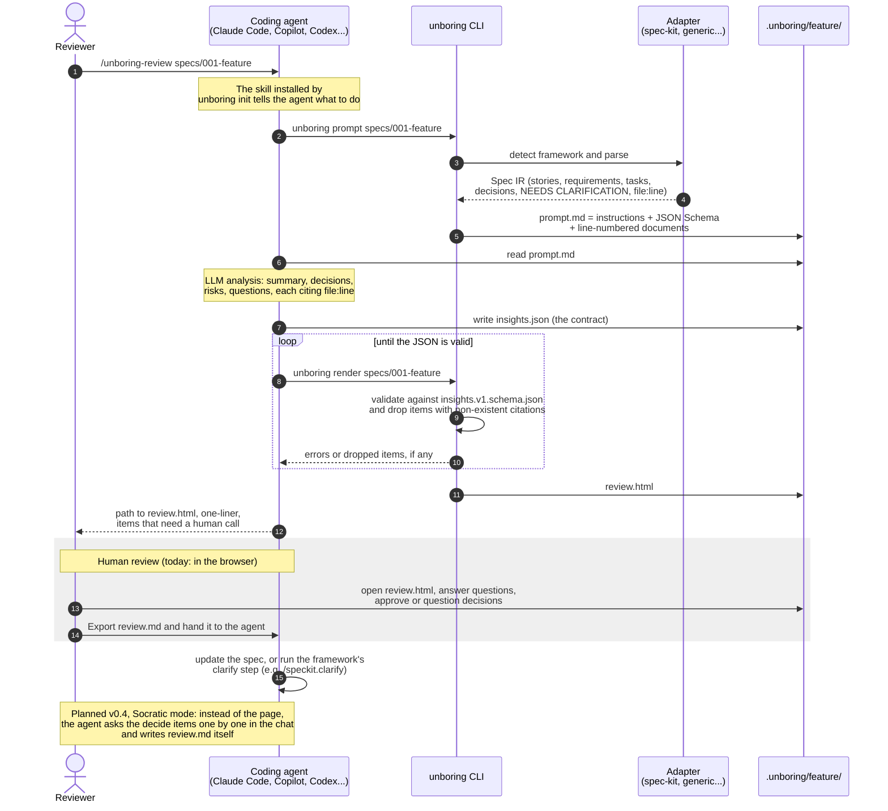

# Contributing to unboringspec

Thanks for helping make spec reviews less exhausting. Contributions of any size are welcome:
bug reports, a new adapter, a new agent integration, design feedback on the review page.

## Development setup

```bash
git clone https://github.com/josluimg/unboringspec && cd unboringspec
python -m venv .venv && source .venv/bin/activate
pip install -e ".[dev,llm]"
pytest
```

Try your change on the example spec:

```bash
unboring review examples/speckit/specs/001-photo-albums --offline --open
```

## How it works

The main flow is **agent mode**: the coding agent the user already runs is the LLM. The CLI never
calls a model in this mode. It only does the deterministic work: parse, check, render.



In **API mode** (`unboring review`, for CI) steps 2 to 11 collapse into one command: the CLI builds the
same prompt, calls a model through LiteLLM and validates the same contract. In **offline mode** there is
no LLM step at all: the page shows only what the adapter extracted.

## How the code is organised

```
src/unboringspec/
  adapters/        one module per SDD framework → produces a SpecIR
  ir.py            SpecIR: the framework-agnostic model (every item carries file:line sources)
  insights.py      the LLM contract: build_prompt → LLMInsights JSON → apply_insights
  integrations.py  where each coding agent expects its skill or command file
  render.py        SpecIR → single self-contained HTML page
  templates/       review page and the agent skill text
  cli.py           init, prompt, render, review, schema
schemas/
  insights.v1.schema.json   the public contract every agent must return (generated, do not edit by hand)
  examples/                 valid responses, checked by tests
tests/
  fixtures/<adapter>/<framework version>/   real-shaped spec folders per tested version
```

Two principles to keep:

1. **Adapters are deterministic.** They only extract what the framework guarantees (headings,
   IDs, checkboxes, markers). Interpretation belongs to the LLM layer.
2. **Every claim is traceable.** Anything shown to the reviewer carries a `SourceRef` to a real
   `file:line`. Never render something the reader cannot verify.

## Add an SDD framework adapter

1. Create `src/unboringspec/adapters/<framework>.py` with a subclass of `Adapter`:
   - `name`: the id users pass to `--adapter`.
   - `tested_with`: the framework version whose templates you checked, e.g. `"kiro 0.6 templates"`.
   - `docs_url`: link to the framework.
   - `detect(path)`: return True only for folders this framework produces. Be specific, so the
     generic adapter stays the fallback.
   - `load(path)`: return a `SpecIR` with whatever the format guarantees: stories, requirements,
     tasks, decisions, clarification markers. Use `read_documents`, `ref` and `find_clarifications`
     from `adapters/base.py`.
2. Report **format drift**: when a document exists but nothing parses, add a message to
   `ir.warnings` that names `tested_with` (see `SpecKitAdapter._drift_warnings`).
3. Register it in `adapters/__init__.py`, before `GenericAdapter`.
4. Add a fixture under `tests/fixtures/<framework>/<version>/` copied from the framework's
   **current templates**, plus tests. A fixture that drifts should produce a warning, not a crash.
5. Add a row to the adapters table in the README.

### When a framework releases a new template version

- Add a new fixture folder for the new version; keep the old one if the old format is still common.
- Update the parsing rules so both pass, then bump `tested_with`.
- If formats are incompatible, it is fine to support only the newest and say so in the README.

## Add a coding agent integration

1. Find where the agent loads skills or custom commands. If it reads Agent Skills (`SKILL.md`),
   it only needs a folder; check how spec-kit integrates the same agent for the convention.
2. Add an `Integration` entry in `integrations.py` with `status="experimental"`.
   If the agent needs another file format (like Gemini's TOML), add a `kind` and handle it in
   `render_integration`. Agent-specific frontmatter goes in `extra_frontmatter` (Claude Code uses it
   for `allowed-tools: Bash(unboring:*)`). Only pre-approve the `unboring` CLI, never broader access.
3. Add it to the agents table in the README.
4. To mark it **tested**, run the full flow in that agent on the example spec
   (`/unboring-review examples/speckit/specs/001-photo-albums`), and mention the agent version in the PR.

The skill text lives in `templates/skill.md` and is shared by every agent. Keep it agent-neutral.

## Changing the insights contract

The contract between agents, API models and the renderer is published as
`schemas/insights.v<N>.schema.json`. Its source of truth is the `LLMInsights` Pydantic model in
`insights.py`; the file is generated from it and `tests/test_contract.py` fails if they drift.

1. Edit the models in `insights.py` (descriptions included: agents read them).
2. Regenerate the published file:
   ```bash
   unboring schema > schemas/insights.v1.schema.json
   ```
3. Update `schemas/examples/` and `SYSTEM_PROMPT` if the meaning of a field changed.
4. Decide the version:
   - **Additive and optional** (a new field with a default): same version.
   - **Breaking** (a field removed or renamed, a new required field, a narrower type): bump
     `SCHEMA_VERSION`, publish a new `insights.v<N+1>.schema.json`, keep the old file in the repo
     and say so in the PR. Agents may run an older installed skill for a while.

Keep the split between strict and lenient: the schema states the rules (for example "at least one
citation"), while `apply_insights` drops the offending item and reports it instead of failing the
whole review.

## Pull requests

- Keep PRs focused: one adapter, one integration or one feature.
- Include tests; `pytest` must pass.
- Describe how you checked it (which spec, which agent, screenshots of the page if UI changed).
- English for code, comments and docs. Example specs can be in any language.

## Reporting a bug

Open an issue with the command you ran, the framework and version, the agent if any, and,
when possible, a minimal spec folder that reproduces it (remove anything private first).
