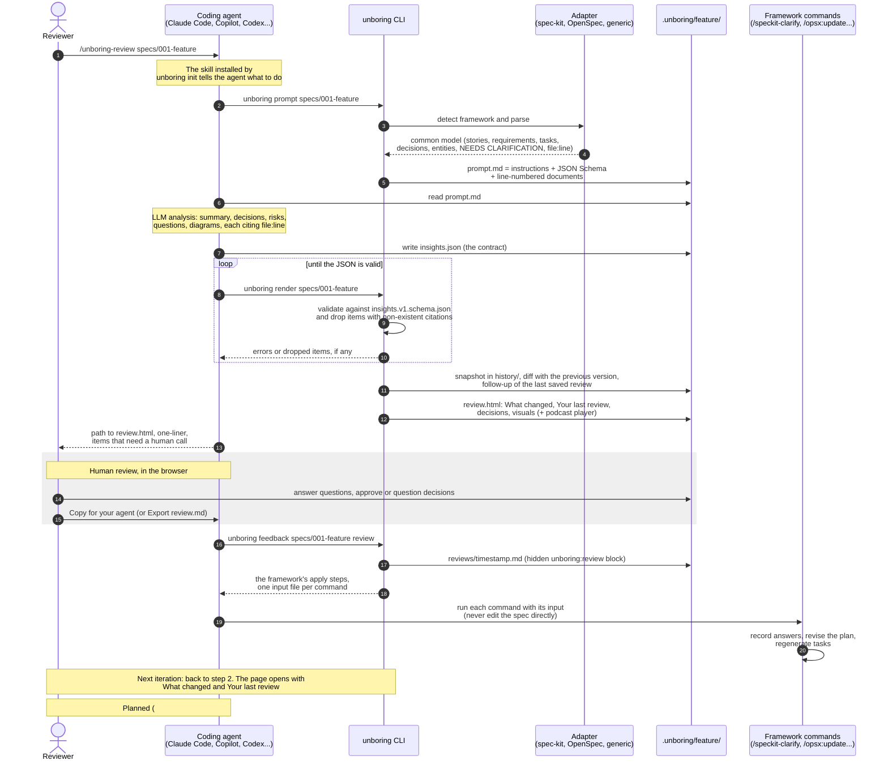
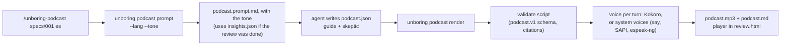

# Contributing to unboringspec

Thanks for helping make spec reviews less exhausting. Contributions of any size are welcome:
bug reports, a new adapter, a new agent integration, design feedback on the review page.

## Development setup

```bash
git clone https://github.com/josluimg/unboringspec && cd unboringspec
python -m venv .venv && source .venv/bin/activate
pip install -e ".[dev,llm]"
pytest
```

Try your change on the example spec:

```bash
unboring review examples/speckit/specs/001-photo-albums --offline --open
```

## How it works

The main flow is **agent mode**: the coding agent the user already runs is the LLM. The CLI never
calls a model in this mode. It only does the deterministic work: parse, check, render.



In **API mode** (`unboring review`, for CI) steps 2 to 12 collapse into one command: the CLI builds the
same prompt, calls a model through LiteLLM and validates the same contract. In **offline mode** there is
no LLM step at all: the page shows only what the adapter extracted.

## How the code is organised

```
src/unboringspec/
  adapters/        one module per SDD framework → produces a SpecIR
  ir.py            SpecIR: the framework-agnostic model (every item carries file:line sources)
  insights.py      the review contract: build_prompt → LLMInsights JSON → apply_insights
  diff.py          semantic diff between two versions of an analysed spec
  history.py       snapshots of previous versions, and the --since git baseline
  feedback.py      saved reviews (hidden unboring:review block) and their follow-up on the next version
  apply.py         routes a review to the framework's own apply commands (adapters declare them)
  diagrams.py      Mermaid diagrams: task graph and data model from the spec, checks for agent diagrams
  podcast.py       the podcast contract: build_podcast_prompt → PodcastScript JSON → validate_script
  tts.py           voice engines (kokoro; system: say, sapi, espeak) and audio assembly
  integrations.py  where each coding agent expects its skill or command file
  render.py        SpecIR → single self-contained HTML page
  templates/       review page and the agent skill text
  cli.py           init, prompt, render, review, schema, podcast (prompt, render, setup, engines)
schemas/
  insights.v1.schema.json   the review contract every agent must return (generated, do not edit by hand)
  podcast.v1.schema.json    the podcast script contract (generated, do not edit by hand)
  examples/                 valid responses, checked by tests
tests/
  fixtures/<adapter>/<framework version>/   real-shaped spec folders per tested version
```

Principles to keep:

1. **Adapters are deterministic.** They only extract what the framework guarantees (headings,
   IDs, checkboxes, markers). Interpretation belongs to the LLM layer.
2. **Every claim is traceable.** Anything shown to the reviewer carries a `SourceRef` to a real
   `file:line`. Never render something the reader cannot verify.
3. **unboringspec reviews; the framework changes the spec.** A review is applied through the
   framework's own commands (`apply_steps()` in the adapter), never by editing spec files, unless
   the framework has none.
4. **Nice-to-haves are opt-in.** Optional features (the podcast, voices) add no files, dependencies
   or downloads unless the user asks for them.

## Add an SDD framework adapter

1. Create `src/unboringspec/adapters/<framework>.py` with a subclass of `Adapter`:
   - `name`: the id users pass to `--adapter`.
   - `tested_with`: the framework version whose templates you checked, e.g. `"kiro 0.6 templates"`.
   - `docs_url`: link to the framework.
   - `detect(path)`: return True only for folders this framework produces. Be specific, so the
     generic adapter stays the fallback.
   - `load(path)`: return a `SpecIR` with whatever the format guarantees: stories, requirements,
     tasks, decisions, clarification markers. Use `read_documents`, `ref` and `find_clarifications`
     from `adapters/base.py`.
2. Report **format drift**: when a document exists but nothing parses, add a message to
   `ir.warnings` that names `tested_with` (see `SpecKitAdapter._drift_warnings`).
3. Register it in `adapters/__init__.py`, before `GenericAdapter`.
4. Declare `apply_steps()`: the framework's own commands that change the spec when a review is applied (which
   files each one owns, where it is installed for each agent). Without them the agent edits the documents
   directly. unboringspec reviews; the framework changes the spec.
5. Add a fixture under `tests/fixtures/<framework>/<version>/` copied from the framework's
   **current templates**, plus tests. A fixture that drifts should produce a warning, not a crash.
6. Add it to the frameworks table in the README (*What it supports*).

### When a framework releases a new template version

- Add a new fixture folder for the new version; keep the old one if the old format is still common.
- Update the parsing rules so both pass, then bump `tested_with`.
- If formats are incompatible, it is fine to support only the newest and say so in the README.

## Add a coding agent integration

1. Find where the agent loads skills or custom commands. If it reads Agent Skills (`SKILL.md`),
   it only needs a folder; check how spec-kit integrates the same agent for the convention.
2. Add an `Integration` entry in `integrations.py` with `status="experimental"`.
   If the agent needs another file format (like Gemini's TOML), add a `kind` and handle it in
   `render_integration`. Agent-specific frontmatter goes in `extra_frontmatter` (Claude Code uses it
   for `allowed-tools: Bash(unboring:*)`). Only pre-approve the `unboring` CLI, never broader access.
3. Add it to the agents table in [docs/setup.md](docs/setup.md#where-each-agent-finds-the-skill) and, once tested,
   to the README.
4. To mark it **tested**, run the full flow in that agent on the example spec
   (`/unboring-review examples/speckit/specs/001-photo-albums`), and mention the agent version in the PR.

Skill texts live in `templates/` (`skill.md`, `skill-podcast.md`) and are shared by every agent. Keep them
agent-neutral. Skills marked `optional=True` in `SKILLS` (the podcast) are only installed when the user asks
(`init --podcast`): nice-to-have features must never add files, dependencies or downloads by default.

## The podcast flow

Same pattern as the review, with a voice step at the end:



## Add a TTS engine

1. Subclass `Engine` in `tts.py`:
   - `check()`: raise `EngineUnavailable` with an actionable message (what to install or run).
   - `voices(lang)`: default voices for the `guide` and the `skeptic`. Pick two clearly different voices.
   - `synth(text, voice, lang, speed, out)`: write one turn as a **24 kHz, mono, 16-bit WAV**. Keeping that
     format lets `assemble` work even without ffmpeg.
   Set `tier` to `"system"` (voices the OS already has) or `"neural"` (a model). When the engine cannot run,
   raise `EngineUnavailable(reason, fix)`: `fix` is the exact command or settings path that solves it, and
   `unboring podcast setup` shows it to the user.
2. Register it in `ENGINES`. System engines are chosen per OS in `SYSTEM_ENGINE`; `--engine auto` tries Kokoro
   first and then the system engine for the current OS.
3. Heavy dependencies go in an optional extra in `pyproject.toml`, imported inside the engine, never at
   module level. Model downloads only happen through an explicit command like `unboring podcast setup`.
4. Add tests with a fake or mocked backend (see `FakeEngine` in `tests/test_podcast.py`), and a row to the
   voice tables in [docs/podcast.md](docs/podcast.md#voices).

## Add a language to the review page

The page's own words (headings, buttons, notices, the exported review's headings) live in
`src/unboringspec/i18n.py`, one table per language; `render --lang <code>` picks one and anything missing
falls back to English. To add a language, copy the `"es"` table, translate every value and keep the
`{placeholders}`; `tests/test_i18n.py` checks that every language has the same keys and placeholders. For
spec-kit specs written in that language, add the template's translated headings and labels to the regular
expressions in `adapters/speckit.py`, with a translated example under `examples/`.

## Changing a contract

There are two published contracts: `schemas/insights.v<N>.schema.json` (review analysis, model
`LLMInsights` in `insights.py`) and `schemas/podcast.v<N>.schema.json` (podcast script, model
`PodcastScript` in `podcast.py`). The files are generated from the models, and `tests/test_contract.py`
and `tests/test_podcast.py` fail if they drift. The steps below use the insights contract; for the podcast
one, regenerate with `unboring schema podcast > schemas/podcast.v1.schema.json`.

1. Edit the models in `insights.py` (descriptions included: agents read them).
2. Regenerate the published file:
   ```bash
   unboring schema > schemas/insights.v1.schema.json
   ```
3. Update `schemas/examples/` and `SYSTEM_PROMPT` if the meaning of a field changed.
4. Decide the version:
   - **Additive and optional** (a new field with a default): same version.
   - **Breaking** (a field removed or renamed, a new required field, a narrower type): bump
     `SCHEMA_VERSION`, publish a new `insights.v<N+1>.schema.json`, keep the old file in the repo
     and say so in the PR. Agents may run an older installed skill for a while.

Keep the split between strict and lenient: the schema states the rules (for example "at least one
citation"), while `apply_insights` drops the offending item and reports it instead of failing the
whole review.

### The saved review format

Reviews exported or copied from the page end with a hidden `<!-- unboring:review {...} -->` block
(`SavedReview` in `feedback.py`): the reviewed version's documents hash and each mark with its stable
key (`review_keys` in `render.py`), kind, text, citation, answer or note. Users keep these files in
`.unboring/<feature>/reviews/` and later versions read them back, so treat it like a contract too:
add fields as optional, never rename or drop one, and keep `buildReview()` in the template and
`SavedReview` in sync (`tests/test_feedback.py` covers the round trip).

## Workflow: issue → branch → pull request

Work is planned as [GitHub issues](https://github.com/josluimg/unboringspec/issues), grouped by
[milestone](https://github.com/josluimg/unboringspec/milestones). Every issue follows the same path:

1. **Pick an issue** (or open one first, so the change is discussed before it is built). Comment on it so
   nobody else starts the same work.
2. **Branch from an up-to-date `main`**, named after the issue: `feature/<issue-number>-<short-slug>`,
   e.g. `feature/17-podcast-length`. Never commit to `main` directly.
3. **Open a pull request against `main`** that says `Closes #<issue-number>` in its description and carries
   the issue's milestone.
4. **Merging the pull request closes the issue**: that is what marks it as done.

## Pull requests

- One issue per pull request. Keep it focused: one adapter, one integration or one feature.
- Include tests; `pytest` must pass.
- Describe how you checked it (which spec, which agent, screenshots of the page if UI changed).
- English for code, comments and docs. Example specs can be in any language.
- The README exists in English and Spanish (`README.es.md`). Change both in the same commit: same sections,
  links, commands and table rows. `tests/test_readmes.py` fails if they drift apart. Only the README is
  translated; `docs/` and this guide stay in English.

## Reporting a bug

Open an issue with the command you ran, the framework and version, the agent if any, and,
when possible, a minimal spec folder that reproduces it (remove anything private first).
