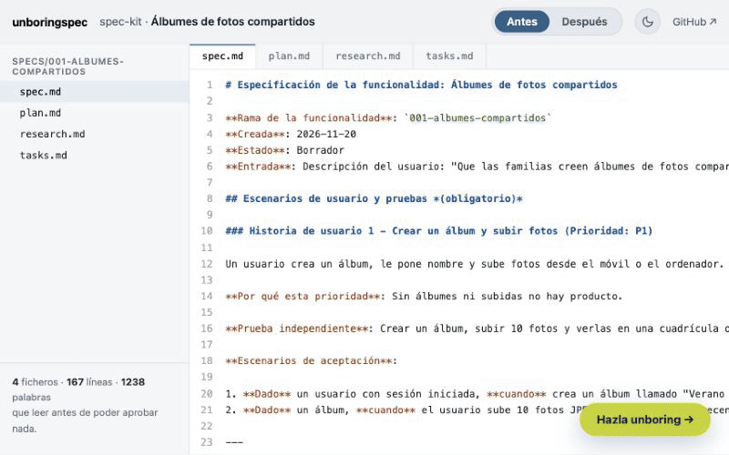

# unboringspec

[English](README.md) · **Español**

**Specs que tu cerebro sí quiere revisar.**

▶️ **[Míralo en directo](https://unboringspec.vercel.app)**: tres specs antes y después, cada una con su podcast. Sin instalar nada.

[](https://unboringspec.vercel.app)

El Spec-Driven Development ha movido el cuello de botella: los agentes escriben el código y tú te pasas el día
leyendo specs, planes, notas de investigación y listas de tareas. Muros de texto donde las tres decisiones que de
verdad te necesitan se esconden en algún punto de la página cuatro.

unboringspec convierte esos muros de texto en dos cosas que sí te apetecerá revisar:

### 🎧 Un podcast sobre tu spec

Dos presentadores repasan tu spec para que puedas revisarla **paseando, de camino al trabajo o mientras se hace
el café**. Uno hace de guía; el otro es el escéptico que hace las preguntas incómodas.

Elige el tono: una charla entre compañeros en el bar, una presentación formal ante el comité de arquitectura, un
**roast** sin piedad, una retransmisión de fútbol en directo, un detective de novela negra… o descríbelo tú:
*"dos piratas discutiendo por un mapa del tesoro"*. Cambian las bromas, no los hechos. Todo lo que se dice es
cierto y va citado, y todas las preguntas abiertas salen a la luz. Con voces generadas en tu máquina, en español,
inglés y seis idiomas más.

### 🗺️ Una revisión visual en lugar de un muro de texto

Una sola página, pensada para tu atención:

- **Primero lo que necesita tu decisión**: preguntas abiertas, compromisos arriesgados y los huecos que vería un
  revisor exigente.
- **Las decisiones se convierten en tarjetas** que apruebas o cuestionas, con las alternativas que descartaron y
  lo que podría salir mal.
- **Diagramas en lugar de prosa**: un mapa del sistema, el flujo principal, el modelo de datos y el grafo de tareas.
- **Cada afirmación enlaza con la línea exacta** de la que sale, a un clic.
- **La siguiente iteración empieza por lo que ha cambiado**, y por lo que pasó con cada punto que señalaste.

<!-- Aquí va el GIF de demostración de la página de revisión y del reproductor del podcast: https://github.com/josluimg/unboringspec/issues/8 -->

Funciona con el framework de SDD que ya usas (spec-kit, OpenSpec…) y con el agente de código que ya tienes
(Claude Code, Copilot, Codex, Cursor, Gemini).

## Empezar

```bash
uv tool install git+https://github.com/josluimg/unboringspec
cd tu-proyecto
unboring init --ai claude --podcast     # o copilot, codex, cursor, gemini
```

Después, en el chat de tu agente, lanza estos dos en este orden: primero la revisión y luego el podcast, que se
apoya en ella.

```text
/unboring-review specs/001-mi-feature                     # 1. la página de revisión
/unboring-podcast specs/001-mi-feature es, en plan roast  # 2. el episodio, añadido a esa página
```

La revisión se abre en tu navegador; cuando el episodio está grabado, se reproduce arriba de esa misma página.

- 📘 **[Guía de instalación y uso](docs/setup.md)**: formas de instalar, cada agente, el ciclo de revisión, CI, tus propios colores y fuentes, y todos los comandos.
- 🎧 **[Guía del podcast](docs/podcast.md)**: tonos, estilos a medida y voces en macOS, Windows y Linux.
- ❓ **[Preguntas frecuentes](docs/faq.md)**: cómo se generan las voces, qué consume tokens y qué no, y los requisitos.

La documentación detallada está en inglés.

## Todo lo que trae la revisión

| | |
|---|---|
| 🎧 **Podcast de la spec** | Un guía y un escéptico, con el tono que elijas. Reproductor y transcripción arriba de la página. |
| 🧭 **Lo que necesita tu decisión** | Solo lo que depende de una persona: marcas `[NEEDS CLARIFICATION]`, compromisos sin resolver y huecos que vería un revisor cuidadoso. |
| 🃏 **Tarjetas de decisión** | Cada decisión con su porqué, las alternativas que descartó y su riesgo. La apruebas o la cuestionas. |
| 🗺️ **Vista visual** | Un mapa del sistema, el flujo principal y las secuencias clave, más el modelo de datos y el grafo de tareas sacados de la spec. Haz clic en cualquier diagrama para verlo a tamaño completo. |
| ⏱️ **Resumen en 30 segundos** | Qué se va a construir, en cinco puntos. |
| 🔁 **Qué ha cambiado** | En la siguiente iteración: preguntas resueltas, decisiones y requisitos cambiados, tareas nuevas o terminadas. Comparado con tu última revisión o con cualquier commit de git. |
| ✅ **Tu última revisión** | Qué pasó con cada punto que señalaste, y tus marcas trasladadas cuando siguen siendo válidas, para que solo revises lo nuevo. |
| 🤝 **Ciclo de revisión** | *Copy for your agent*: tu agente aplica la revisión con los propios comandos de tu framework (`/speckit-clarify`, `/opsx:update`…). |
| 🔗 **Trazabilidad** | Cada afirmación enlaza con su `fichero:línea`, y la fuente se abre junto al resumen. Las citas inventadas se descartan. |
| 📂 **Información por capas** | Las decisiones rutinarias, historias, tareas y requisitos quedan plegados hasta que los necesites. |

## Qué soporta

**Frameworks de SDD**, mediante adapters. Cada uno indica con qué versión del framework está probado y avisa si un
documento deja de reconocerse (señal de que la plantilla ha cambiado) en vez de mostrar una revisión vacía.

| Framework | Estado |
|---|---|
| [spec-kit](https://github.com/github/spec-kit) | ✅ probado con las plantillas de v1.4.4 · revisa una feature: `specs/<feature>/` |
| [OpenSpec](https://github.com/Fission-AI/OpenSpec) | ✅ probado con v2.2.0 · revisa un cambio: `openspec/changes/<change>/`, con los requisitos ADDED / MODIFIED / REMOVED / RENAMED etiquetados |
| Cualquier carpeta de Markdown | ✅ adapter genérico; el análisis lo hace el LLM |
| Kiro, BMAD | 🛣️ buscamos ayuda: [añade un adapter](CONTRIBUTING.md#add-an-sdd-framework-adapter) |

**Agentes de código**, mediante [Agent Skills](https://agentskills.io): tu agente hace el análisis.

| Agente | Estado |
|---|---|
| Claude Code | ✅ probado de principio a fin |
| GitHub Copilot (VS Code), OpenAI Codex, Cursor, Gemini CLI | 🧪 experimental: sigue el formato de cada agente, pero aún nadie ha reportado una prueba completa |

**Sin agente** (CI): cualquier modelo compatible con [LiteLLM](https://docs.litellm.ai/docs/providers), con tu API key.
Consulta [In CI](docs/setup.md#in-ci).

**Voces del podcast**, todas generadas en local: las voces del sistema en macOS, Windows y Linux, o voces naturales
con [Kokoro](https://huggingface.co/hexgrad/Kokoro-82M) en 8 idiomas. Consulta [Voices](docs/podcast.md#voices).

## Cómo funciona

```
carpeta de la spec ──adapter──▶ modelo común ──▶ prompt ──▶ tu agente (o un modelo por API) ──▶ JSON ──▶ página de revisión
(spec-kit, OpenSpec...)  (cada elemento con fichero:línea)                                (contrato)  (+ podcast)

página de revisión ──tu revisión──▶ unboring feedback ──▶ comandos de tu framework ──▶ siguiente render:
                                                          (/speckit-clarify, /opsx:update…)  Qué ha cambiado + Tu última revisión
```

La CLI hace el trabajo determinista: leer la spec, validar las citas, generar la página y comparar versiones. Tu
agente hace la interpretación. **unboringspec revisa; tu framework cambia la spec**: tu revisión se aplica con los
propios comandos del framework, nunca editando la spec a sus espaldas.

Sea cual sea el framework o el modelo, la respuesta sigue un contrato publicado y versionado:
[`insights.v1`](schemas/insights.v1.schema.json) para la revisión y [`podcast.v1`](schemas/podcast.v1.schema.json)
para el guion del podcast, con [ejemplos](schemas/examples/). Los cambios incompatibles llevan un fichero de versión nuevo.

El flujo completo, paso a paso, está en el diagrama de [CONTRIBUTING.md](CONTRIBUTING.md#how-it-works).

## Contribuir

Los adapters para nuevos frameworks, las integraciones con agentes y los motores de voz son las aportaciones más
valiosas. Empieza por [CONTRIBUTING.md](CONTRIBUTING.md) o elige una issue [`help wanted`](https://github.com/josluimg/unboringspec/labels/help%20wanted).

## Licencia

[MIT](LICENSE)
