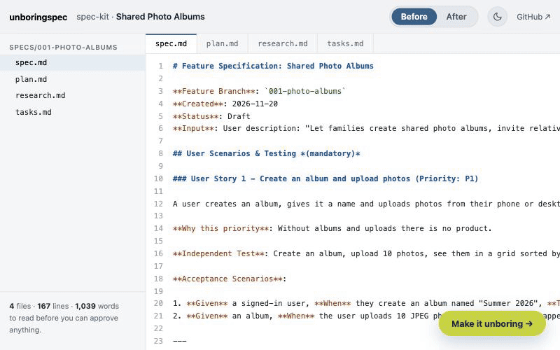

# unboringspec

**English** · [Español](README.es.md)

**Specs your brain actually wants to review.**

▶️ **[See it live](https://unboringspec.vercel.app)**: three specs before and after, each with its podcast. Nothing to install.

[](https://unboringspec.vercel.app)

Spec-Driven Development moved the bottleneck: agents write the code, and you spend your day reading specs,
plans, research notes and task lists. Walls of text, where the three decisions that really need you hide
somewhere on page four.

unboringspec turns those walls of text into two things you will actually enjoy:

### 🎧 A podcast about your spec

Two hosts talk your spec through, so you can review it **on a walk, on your commute or
while the coffee brews**. One is the guide; the other is the skeptic who asks the uncomfortable questions.

Pick the vibe: a chat between colleagues at the bar, a formal briefing for the architecture board, a no-mercy
**roast**, live football commentary, a noir detective on the case… or describe your own: *"two pirates arguing
over a treasure map"*. The jokes change; the facts don't. Every claim is true and cited, and every open question
gets asked. Voiced on your machine, in English, Spanish and six more languages.

### 🗺️ A visual review instead of a wall of text

One page, built around your attention:

- **What needs your call comes first**: open questions, risky trade-offs, the gaps a sharp reviewer would raise.
- **Decisions become cards** you approve or question, with the alternatives they beat and what could go wrong.
- **Pictures instead of prose**: a map of the system, the main flow, the data model and the task graph.
- **Every claim links to the exact line** it came from, one click away.
- **The next iteration opens with what changed**, and with what became of each point you raised.

<!-- Demo GIF of the review page and the podcast player goes here: https://github.com/josluimg/unboringspec/issues/8 -->

It plugs into the SDD framework you use (spec-kit, OpenSpec…) and the coding agent you already have
(Claude Code, Copilot, Codex, Cursor, Gemini).

## Get started

```bash
uv tool install git+https://github.com/josluimg/unboringspec
cd your-project
unboring init --ai claude --podcast     # or copilot, codex, cursor, gemini
```

Then, in your agent's chat, run these two in this order: first the review, then the podcast, which builds on it.

```text
/unboring-review specs/001-my-feature                  # 1. the review page
/unboring-podcast specs/001-my-feature es, roast it    # 2. the episode, added to that page
```

The review opens in your browser; once the episode is recorded, it plays at the top of the same page.

- 📘 **[Setup and usage guide](docs/setup.md)**: install options, every agent, the review loop, CI, your own colours and fonts, all commands.
- 🎧 **[Podcast guide](docs/podcast.md)**: tones, custom styles, and voices on macOS, Windows and Linux.
- ❓ **[FAQ](docs/faq.md)**: how the voices are made, what costs tokens and what doesn't, requirements.

## Everything in the review

| | |
|---|---|
| 🎧 **Spec podcast** | A guide and a skeptic, in the tone you choose. Player and transcript at the top of the page. |
| 🧭 **Needs your judgment** | Only what is blocked on a human: `[NEEDS CLARIFICATION]` markers, unresolved trade-offs, gaps a careful reviewer would raise. |
| 🃏 **Decision cards** | Each decision with its rationale, the alternatives it beat and its risk. Approve it or question it. |
| 🗺️ **Visual overview** | A map of the system, the main flow and key sequences, plus the data model and the task graph built from the spec. Click any diagram to see it full size. |
| ⏱️ **30-second summary** | What is being built, in five bullets. |
| 🔁 **What changed** | On the next iteration: questions resolved, decisions and requirements changed, tasks added or done. Compared with your last review or any git commit. |
| ✅ **Your last review** | What became of each point you raised, and your marks carried over when they still hold, so you only review what is new. |
| 🤝 **Feedback loop** | *Copy for your agent*: it applies your review through your framework's own commands (`/speckit-clarify`, `/opsx:update`…). |
| 🔗 **Traceability** | Every claim links to its `file:line`; the source opens beside the summary. Invented citations are dropped. |
| 📂 **Progressive disclosure** | Routine decisions, stories, tasks and requirements stay collapsed until you want them. |

## What it supports

**SDD frameworks** through adapters. Each one states the framework version it was tested with, and warns if a
document no longer parses (a sign the template changed) instead of showing an empty review.

| Framework | Status |
|---|---|
| [spec-kit](https://github.com/github/spec-kit) | ✅ tested with v1.4.4 templates · review a feature: `specs/<feature>/` |
| [OpenSpec](https://github.com/Fission-AI/OpenSpec) | ✅ tested with v2.2.0 · review a change: `openspec/changes/<change>/`, with ADDED / MODIFIED / REMOVED / RENAMED requirements tagged |
| Any folder of Markdown | ✅ generic adapter; the LLM does the analysis |
| Kiro, BMAD | 🛣️ wanted: [add an adapter](CONTRIBUTING.md#add-an-sdd-framework-adapter) |

**Coding agents** through [Agent Skills](https://agentskills.io): your agent does the analysis.

| Agent | Status |
|---|---|
| Claude Code | ✅ tested end to end |
| GitHub Copilot (VS Code), OpenAI Codex, Cursor, Gemini CLI | 🧪 experimental: follows each agent's format, not yet reported in a full run |

**Without an agent** (CI): any model [LiteLLM](https://docs.litellm.ai/docs/providers) supports, with your API key.
See [In CI](docs/setup.md#in-ci).

**Podcast voices**, all generated locally: system voices on macOS, Windows and Linux, or natural voices with
[Kokoro](https://huggingface.co/hexgrad/Kokoro-82M) in 8 languages. See [Voices](docs/podcast.md#voices).

## How it works

```
spec folder ──adapter──▶ common model ──▶ prompt ──▶ your agent (or an API model) ──▶ JSON ──▶ review page
(spec-kit, OpenSpec...)  (every item has file:line)                                  (contract)  (+ podcast)

review page ──your review──▶ unboring feedback ──▶ framework's own commands ──▶ next render:
                                                   (/speckit-clarify, /opsx:update…)  What changed + Your last review
```

The CLI does the deterministic work: parsing the spec, validating citations, rendering, comparing versions.
Your agent does the interpretation. **unboringspec reviews; your framework changes the spec**: your review is
applied through the framework's own commands, never by editing the spec behind its back.

Whatever the framework or the model, the answer follows a published, versioned contract:
[`insights.v1`](schemas/insights.v1.schema.json) for the review and [`podcast.v1`](schemas/podcast.v1.schema.json)
for the podcast script, with [examples](schemas/examples/). Breaking changes get a new version file.

The full flow, step by step, is diagrammed in [CONTRIBUTING.md](CONTRIBUTING.md#how-it-works).

## Contributing

New framework adapters, agent integrations and voice engines are the most valuable contributions.
Start with [CONTRIBUTING.md](CONTRIBUTING.md), or pick a [`help wanted`](https://github.com/josluimg/unboringspec/labels/help%20wanted) issue.

## License

[MIT](LICENSE)
